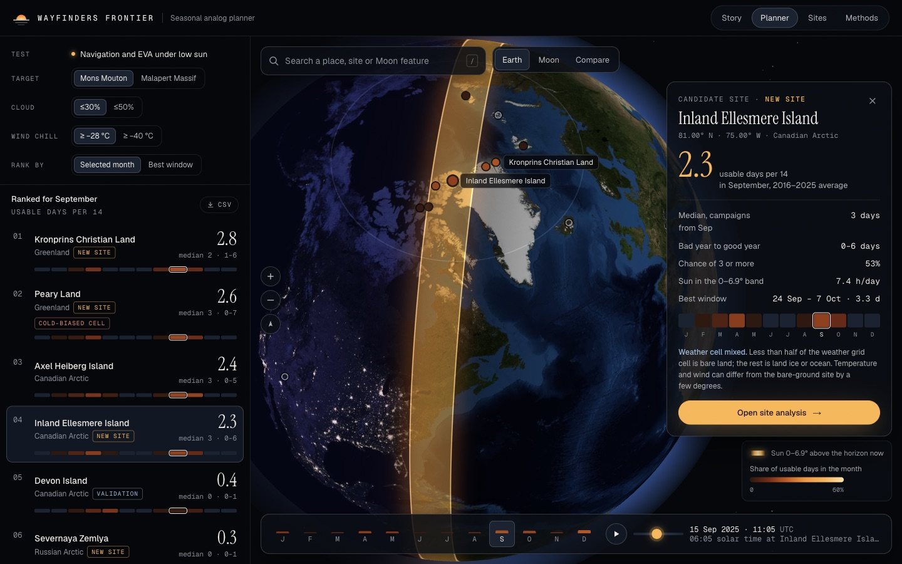
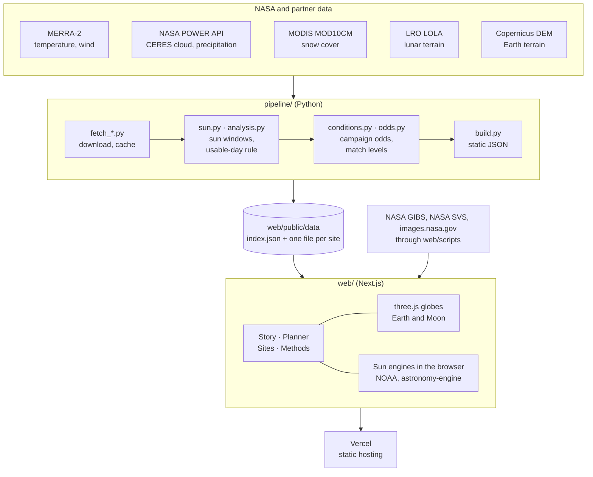
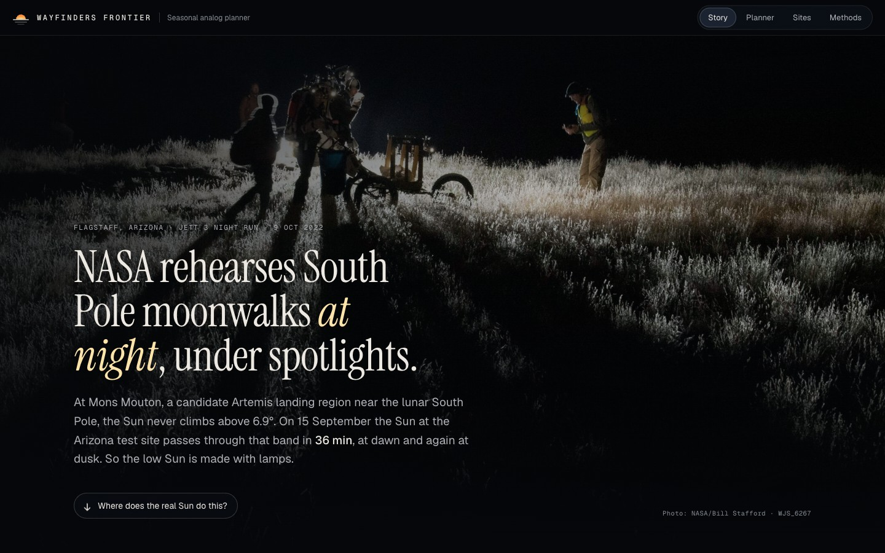
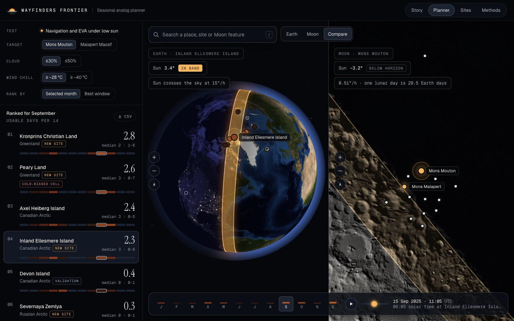
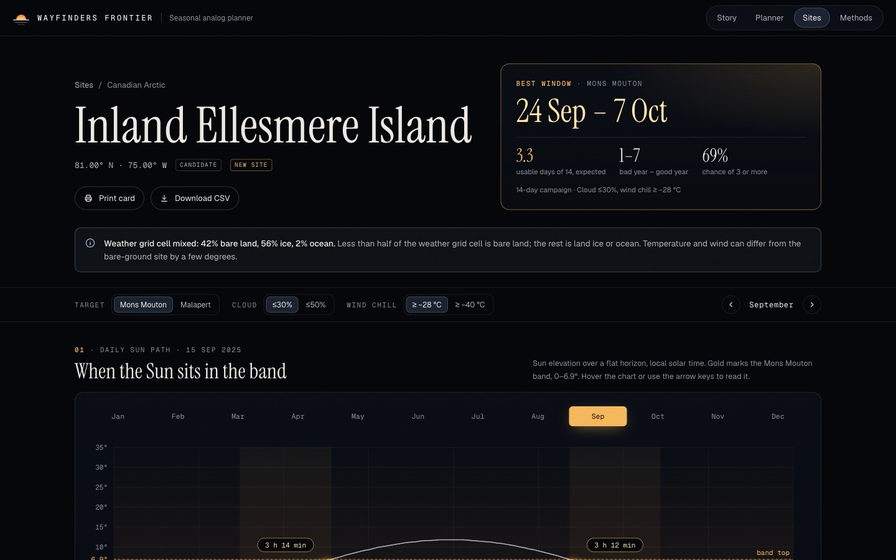
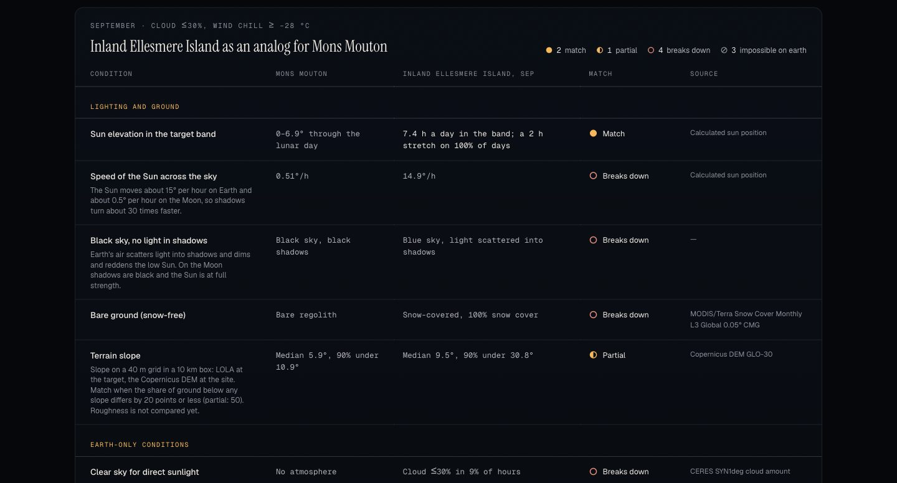
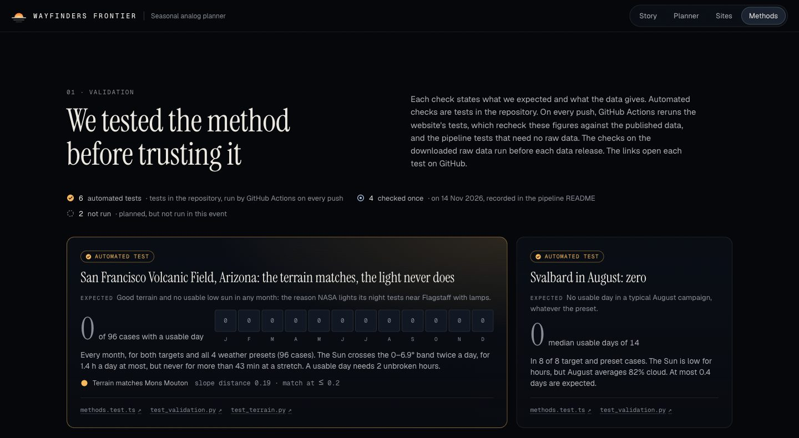

# Wayfinders Frontier: Seasonal Analog Planner

**NASA Space Apps Challenge 2026** · Challenge: [Identify Earth Locations that Analog the Permanent Moon Base Locations and Mars](https://www.spaceappschallenge.org/2026/challenges/permanent-moon-base-locations-and-mars/)

**Live site:** https://nasa-space-apps-2026-liart.vercel.app/

> **An Earth analog is a place at the right time.** The planner finds where and when on Earth the Sun sits as low as at the lunar South Pole, how faithful each site is for a test, and how many usable test days the weather allows.



## Challenge and problem

### The challenge
Identify and map locations on Earth that have scientific and environmental similarities to potential permanent Moon base locations and Mars, using NASA satellite observations and planetary datasets. A solution should compare the analogs with measured data, go beyond the well-known analog sites, show how each location helps test landing, navigation, robotics, mobility and other systems, and explain where the analogy breaks down.

### The problem we address
NASA plans its Moon base near the lunar South Pole. There the Sun never climbs more than a few degrees above the horizon: at Mons Mouton, a candidate Artemis landing region, it stays between 0° and 6.9°. Long shadows and hard contrast are the conditions that navigation cameras, rovers and astronauts on foot must work in, and they are the hardest to reproduce on Earth.

Analog sites are usually treated as fixed places, and campaign dates are chosen for logistics. At NASA's Arizona test site the Sun crosses the 0–6.9° band twice a day, but never for more than 43 minutes at a stretch, so South Pole moonwalks are rehearsed at night under spotlights. Yet the light that makes a site Moon-like depends on the season. In the High Arctic in spring and autumn the real Sun stays this low for hours each day, and then the weather decides which of those hours a team can use.

**Who it is for:** the field-test lead who decides where and when a test of a South Pole surface system takes place (EVA, rover mobility, navigation cameras), has to justify the site and dates, and needs to know which results will carry over to the Moon.

**The question the planner answers:** *Where and when on Earth should we test this, how faithful will it be, and how many usable days will we get?*

## Team

**Team name:** Wayfinders Frontier

| Name | Home institution | GitHub | Role |
|---|---|---|---|
| Ansul Suryawanshi | Indira Gandhi National Open University (IGNOU) | [Ansul-S](https://github.com/Ansul-S) | Team Leader |
| Tabassum Shakeel Ansari | G.H. Raisoni Skill Tech University | [tabassumansari1](https://github.com/tabassumansari1) | Team Researcher |
| Aamrapali Khobragade | G.H. Raisoni Skill Tech University | [aamrapalikhobragade25](https://github.com/aamrapalikhobragade25) | Team Researcher |

## Solution overview and architecture

### What it does
| Page | What the user gets |
|---|---|
| **Story** (`/`) | The problem in one scroll: NASA's night-time tests, the low Sun at the South Pole, and where on Earth the real Sun does the same. |
| **Planner** (`/planner/`) | Choose a lunar target (Mons Mouton or Malapert Massif), a cloud limit, a wind-chill limit and a month. The 14 Earth sites are ranked by the usable test days a 14-day campaign can expect. A 3D globe shows the low-sun ring at any hour; any place on Earth can be searched for its low-sun hours and the calculated sites that fill its gaps. The Moon view and the side-by-side **Compare** view show the same moment on both bodies. The ranking exports as CSV. |
| **Sites** (`/sites/`, `/sites/<id>/`) | For each site: the best 14-day window, the daily sun path, a 12-month calendar for every condition, campaign odds, and a **fidelity card** that rates each condition as match, partial, breaks down or impossible on Earth, with its data source. Each site page prints as a one-page card and exports as CSV. |
| **Methods** (`/methods/`) | The validation checks, the usable-day rule, the campaign odds, the match levels, the data and the limits. |

### How it works
- **Sun band.** For each lunar target the band runs from 0° to (90° − |target latitude|) + 1.5°: 6.9° at Mons Mouton and 5.5° at Malapert Massif. Sun positions on Earth are calculated every 5 minutes with the NOAA solar algorithm, checked against NREL SPA to within 0.02°.
- **Usable day.** The Sun stays in the band for at least 2 unbroken hours, and during that stretch the cloud amount is at most 30% (or 50%), the wind is within limits, the wind chill is at least −28 °C (or −40 °C), and the day's precipitation is under 1 mm.
- **Campaign odds.** Ten years of hourly data (2 Jan 2016 to 30 Dec 2025). Every day of the record starts one 14-day campaign; the best window's expected usable days are scored on years held out from its choice, so hindsight does not flatter the figure.
- **Terrain.** Slope in a 10 km box on the same 40 m grid on both bodies: LRO LOLA at the lunar target, the Copernicus DEM at the Earth site, compared with the Kolmogorov-Smirnov distance.
- **Limits stated, not hidden.** The fidelity card always marks the Sun's speed across the sky and the black sky as breaking down, and gravity, vacuum and radiation as impossible on Earth.

The full method, data contract and limits are in [`pipeline/README.md`](pipeline/README.md).

### Results at the default settings
Mons Mouton, cloud ≤30%, wind chill ≥ −28 °C. Expected usable days in the best 14-day window, scored on held-out years:

| Site | Region | Best window | Usable days of 14 | Note |
|---|---|---|---|---|
| Peary Land (Jørgen Brønlund Fjord) | Greenland | 21 Sep – 4 Oct | 4.5 | New site. Its weather cell is mostly ice sheet, so this figure is too pessimistic. |
| Kronprins Christian Land (Station Nord) | Greenland | 18 Sep – 1 Oct | 3.8 | New site |
| Vestfold Hills | Antarctica | 22 Dec – 4 Jan | 3.7 | New site |
| Inland Ellesmere Island | Canadian Arctic | 24 Sep – 7 Oct | 3.3 | New site |
| Devon Island (Haughton crater) | Canadian Arctic | 30 Apr – 13 May | 3.0 | Known analog, used for validation |
| San Francisco Volcanic Field | Arizona | none | 0 | Known analog, used for validation: the terrain matches, the light never does |

### Architecture
The pipeline does all the heavy calculation in advance and writes static JSON. The website is a static export that reads those files, so it needs no server and no API keys.



GitHub Actions runs the pipeline and website tests on every push.

### Tech stack
| Layer | Technology |
|---|---|
| Data pipeline | Python 3.11, uv, NumPy, pandas, xarray, netCDF4, rasterio, requests, earthaccess (NASA Earthdata) |
| Pipeline tests | pytest, with pvlib (NREL SPA) as an independent sun-position reference |
| Website | Next.js 16 (App Router, static export), React 19, TypeScript 5, Tailwind CSS 4 |
| Globes and charts | three.js with custom GLSL shaders, d3-scale and d3-shape, Motion |
| Astronomy in the browser | NOAA sun algorithm ported from the pipeline; astronomy-engine for the Sun on the Moon |
| Website tests and quality | Node.js test runner, ESLint, TypeScript type check |
| Image scripts | Python, NumPy, Pillow |
| Place search | Photon geocoder (OpenStreetMap data) |
| Hosting and CI | Vercel (static hosting), GitHub Actions |

## Live demo and screenshots

**Live site:** https://nasa-space-apps-2026-liart.vercel.app/

**Demo video (30 s):** https://drive.google.com/file/d/1rf3Qz4TJ5HZ-Tp0REBd9O-GFiZHtVyp0/view

- Open the Earth and Moon comparison directly: https://nasa-space-apps-2026-liart.vercel.app/planner/?view=compare
- A site page: https://nasa-space-apps-2026-liart.vercel.app/sites/ellesmere-inland/

**Story.** NASA rehearses South Pole moonwalks at night, under spotlights. The story asks where the real Sun does this.



**Planner.** Sites ranked for a 14-day campaign at Mons Mouton in September, with the low-sun ring on the globe and the selected site's odds.


**Compare.** The same moment at Inland Ellesmere Island and at Mons Mouton: the Sun in the band on Earth, and how slowly it moves on the Moon.



**Site page.** The best window, the expected usable days and the daily sun path through the band.



**Fidelity card.** Where the analog holds and where it breaks, condition by condition, with the data source.



**Validation.** The checks behind the numbers, each linked to its test in this repository.



## Installation and setup

### Requirements
- Git
- Node.js 22 and pnpm 12.4.2 (the version in `web/package.json`)
- Python 3.11 or newer and [uv](https://docs.astral.sh/uv/), for the pipeline

### Get the code
```bash
git clone https://github.com/Ansul-S/nasa-space-apps-2026.git
cd nasa-space-apps-2026
```

### Run the website
The calculated data is in the repository (`web/public/data`), so the website builds without downloading anything.
```bash
cd web
npm install --global pnpm@12.4.2
pnpm install --frozen-lockfile
pnpm build                                 # static site in web/out
python3 -m http.server 4173 -d out         # open http://localhost:4173/
```
Checks: `pnpm test` (137 tests), `pnpm lint`, `pnpm typecheck`.

### Run the pipeline tests
```bash
cd pipeline
uv sync
uv run pytest -q
```
There are 56 tests. The 14 that check results against the downloaded raw data skip themselves when `pipeline/data/raw` is missing.

### Rebuild the data
Downloading the raw data needs a free [NASA Earthdata](https://urs.earthdata.nasa.gov/) account. The download commands are in the docstrings of `fetch_merra2.py`, `fetch_power.py` and `fetch_snow.py`; then:
```bash
cd pipeline
uv run python -m analog_pipeline.fetch_terrain   # writes config/terrain.json
uv run python -m analog_pipeline.build           # writes ../web/public/data
```
The globe textures and story photographs are rebuilt with the scripts in `web/scripts/` (see [`web/README.md`](web/README.md)).

### Project layout
```
pipeline/             Python data pipeline
  src/analog_pipeline/  downloads, sun position, usable-day rule, odds, JSON export
  config/               sites, lunar targets, weather-cell and terrain constants
  tests/                unit tests and validation checks
web/                  Next.js website (static export)
  src/                  pages, components and the browser-side calculations
  public/data/          pipeline output: index.json and one file per site
  public/textures/      globe imagery
  public/photos/        NASA photographs
  scripts/              image download and resize scripts
Research/             challenge resource analysis and problem research
docs/screenshots/     screenshots for this README
.github/workflows/    tests on every push
```

## AI Usage Disclosure

### Tools
- **Claude Code** (Anthropic), an AI coding agent, using Claude Opus models. Through it we also used browser automation (Playwright) to check the built website and to take the screenshots in this README.
- No other AI tools were used.

### Summary
Most of the code, tests and written documentation in this repository were generated by Claude Code from our instructions. We set the problem, the concept, the features, the scope and the design direction, approved each step before it was built, and reviewed, tested and committed every change.

### By component
| Component | Files | How AI was used | What the team did |
|---|---|---|---|
| Research and planning | `Research/` | Searched literature and data sources; drafted the problem, user, approach, proposal and roadmap documents | Chose the challenge; proposed the core idea (an analog is a place at the right time); chose the features and the scope cuts; approved the roadmap |
| Data pipeline | `pipeline/src/analog_pipeline/` | Wrote the sun-position engine, data downloaders (MERRA-2, NASA POWER, MODIS, LOLA, Copernicus DEM), usable-day rule, campaign odds and JSON export | Set up the NASA Earthdata account and data access; set the usable-day rule and its limits; ran the data downloads; reviewed the results |
| Pipeline tests | `pipeline/tests/` | Wrote the tests, including the check against NREL SPA (pvlib) and the validation checks on real data | Defined the expected results (Arizona 0 usable days, Svalbard in August, Ellesmere April vs March) |
| Website | `web/src/` | Wrote the Next.js app: three.js globes and shaders, planner, site pages, sites overview, charts, fidelity card, CSV export, print card, methods page, Compare link | Chose the look ("Low-Sun Observatory"), the team brand, one globe engine for Earth and Moon, and the Moon as a compare mode; reviewed every screen and asked for changes |
| Website tests | `web/src/lib/*.test.ts` | Wrote unit tests (browser sun engine vs pipeline output, ranking, export, colour contrast) | Reviewed the results |
| Continuous integration | `.github/workflows/tests.yml` | Wrote the workflow | Approved it, made the commit and checked the first run |
| Image scripts | `web/scripts/` | Wrote the scripts that download and resize NASA imagery and photos | Chose the photographs |
| Brand mark and visual design | `BrandMark.tsx`, `app/icon.svg`, `globals.css` | Drew the mark and colour system as code; made an interactive prototype before the build | Chose the direction and approved the final design |
| Documentation | `README.md`, `pipeline/README.md`, `web/README.md` | Drafted the text | Reviewed and edited it |
| Commit messages | git history | Drafted the messages | Reviewed, made and pushed every commit; AI is never a commit author |

### What is not AI-generated
- **Data.** Every number on the site comes from NASA and partner datasets (MERRA-2, CERES, MODIS, LRO LOLA, Copernicus DEM), processed by the pipeline in this repository. No value was produced or estimated by an AI model, and no AI model runs in the application.
- **Images.** All photographs are NASA photographs from images.nasa.gov, credited where they appear. Globe imagery is NASA GIBS and NASA SVS data. No AI-generated images are used.

### How AI output was checked
- Automated tests: 56 pipeline tests and 137 website tests, run before every commit and by GitHub Actions on every push (in CI the 14 pipeline tests that need the downloaded raw data skip themselves). They include the sun engine against an independent implementation (NREL SPA, within 0.02°) and the validation checks shown on the Methods page.
- A separate re-implementation of the usable-day calculation agreed with the pipeline (14 Nov 2026).
- MERRA-2 temperatures compared with weather-station normals at Arctic sites.
- Every page checked in a browser at desktop and phone widths; the print card checked as one page on A4 and US Letter for all 14 sites; CSV exports opened in pandas.

## License and credits
The code is released under the [MIT License](LICENSE). The data, imagery and photographs it uses keep their own terms:

- **Weather and snow:** MERRA-2 (NASA GES DISC); CERES SYN1deg cloud and MERRA-2 precipitation through the NASA POWER API; MODIS/Terra MOD10CM snow cover.
- **Terrain:** LRO LOLA polar elevation model (NASA PDS Geosciences Node). Copernicus DEM GLO-30 © DLR e.V. 2010–2014 and © Airbus Defence and Space GmbH 2014–2018, provided under COPERNICUS by the European Union and ESA; all rights reserved.
- **Globe imagery:** NASA GIBS Blue Marble and VIIRS Black Marble; NASA SVS CGI Moon Kit (LRO LROC colour, LOLA elevation).
- **Moon feature positions:** USGS Gazetteer of Planetary Nomenclature (IAU).
- **Photographs:** NASA Image and Video Library (images.nasa.gov), credited on the site where they appear. Their use does not imply endorsement by NASA.
- **Place search:** Photon, © OpenStreetMap contributors.
